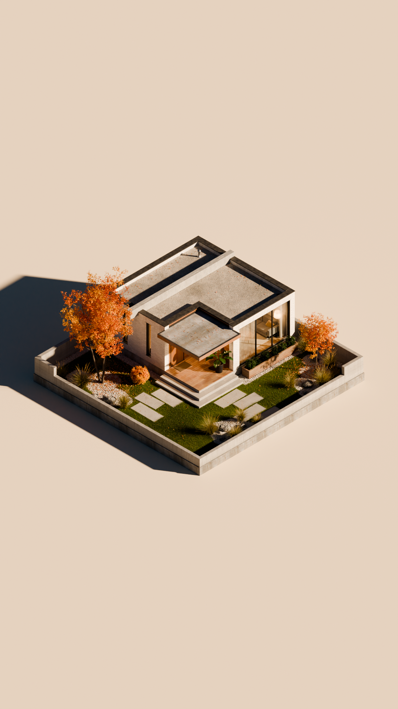
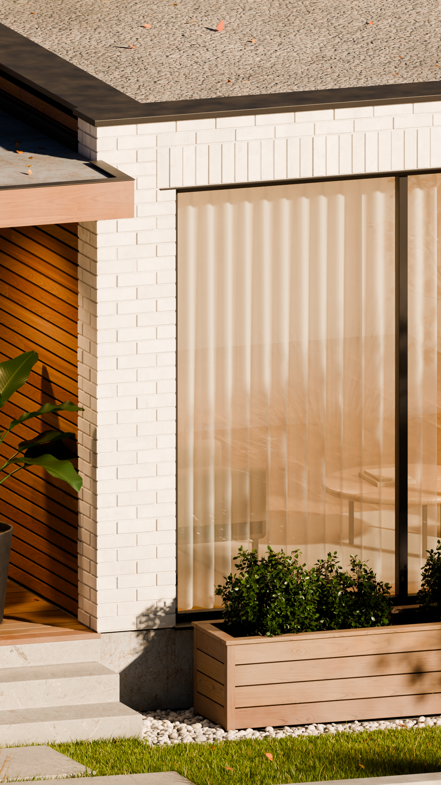
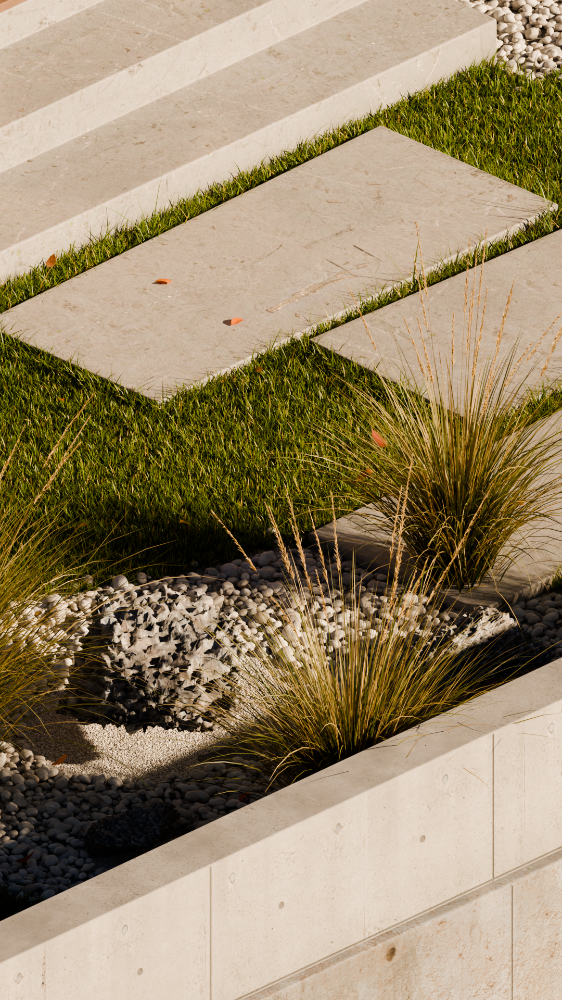

# Laporan: Diorama Rumah Minimalis 3D (bpy, Cycles CPU)

Laporan ini nyeritain pengerjaan dari perintah pertama sampe file terakhir di-push. Semua jam ditulis dalam WIB, sedangkan `output/render_log.txt` pake UTC (WIB dikurangi 7 jam). Angka di sini diambil dari log render, log tiap putaran, dan hasil ffprobe. Bagian yang isinya penilaian gw sendiri gw tandai sebagai opini.

## 1. Ringkasan

| Hal | Hasil |
|---|---|
| Video | `output/house_diorama.mp4`, 120 frame, 1080x1920, 24 fps, 5,00 detik |
| Codec | H.264 High, yuv420p, bt709, 33,7 Mb/s, 21,05 MB |
| Still frame 60 | `output/still_f060.png` |
| Close-up | `output/closeup_facade.png`, `output/closeup_garden.png` |
| Script | `house_diorama.py` (2.728 baris), `render_anim.sh` (watchdog) |
| Render video | 119 frame dalam 18,33 jam, rata-rata 554,4 detik per frame |
| Total pengerjaan | 21 jam 3 menit dari perintah pertama sampe MP4 jadi |
| Branch | `claude/minimalist-house-diorama-3d-596x0y`, tanpa PR |



Penilaian gw (opini): dari jarak diorama, cahaya dan materialnya udah masuk kelas archviz. Vegetasi dan properti kecil masih ketauan CG begitu di-zoom, dan batu taman gagal total kalo diliat dari deket.

## 2. Lingkungan kerja

Mesinnya container cloud dengan 4 core Intel Xeon, RAM sekitar 16 GB, tanpa GPU. Blender dipake lewat wheel `bpy` 5.3.0 di Python 3.13, jalan headless dengan Cycles CPU dan denoiser OpenImageDenoise.

Jaringan ke Poly Haven ternyata kebuka, jadi material ga murni prosedural. Gw unduh 20 set tekstur PBR berlisensi CC0 ukuran 2k (659 MB), isinya plester, beton, veneer kayu, kulit kayu, batu, tanah, kerikil, dan kain. HDRI ga gw pake karena langitnya udah diisi physical sky.

## 3. Kronologi

| Waktu (WIB) | Kejadian |
|---|---|
| 26 Nov 01.16 | Mulai. Cek mesin, jaringan, ketersediaan bpy |
| 01.17 sampe 01.38 | Pasang bpy, pilih tekstur dari thumbnail, unduh 20 set |
| 01.35 sampe 02.08 | Nulis script bertahap: material, arsitektur, taman, vegetasi, interior. Tiap tahap di-preview |
| 02.08 sampe 02.19 | Putaran 1, still frame 60 di setting final |
| 02.21 sampe 03.28 | Perbaikan putaran 2 plus uji noise dan sampling |
| 03.28 sampe 03.37 | Putaran 2 |
| 03.38 sampe 03.47 | Putaran 3 |
| 03.50 sampe 03.58 | Putaran 4, hasilnya jadi frame 60 video |
| 03.59 | Render 120 frame mulai di background |
| 13.05 | Semua frame ganjil kelar, versi interim 12 fps di-push sebagai cadangan |
| 22.19 | Frame terakhir kelar, MP4 ke-encode otomatis |
| 22.21 | Verifikasi, push video dan log |
| 23.33 | Dua close-up setting final di-push |

## 4. Isi scene

Semua geometri dibangun dari kode, ga ada model jadi yang diimpor.

Rumahnya kotak 7 x 7 m dengan puncak parapet 3,225 m dari permukaan alas. Dindingnya disusun bata satu-satu (215 x 65 x 102,5 mm, nat 10 mm) sebanyak 37 lapis dengan pola running bond, lengkap dengan lapis bata berdiri di atas bukaan dan sambungan di sudut. Coakan teras 2,5 x 2,5 m dilapis bilah kayu, punya pintu kayu, lantai deck, dan kanopi plat beton yang menjorok 0,50 m. Jendela besarnya pake kaca yang punya ketebalan, dan di baliknya ada gorden tipis, sofa, kursi, meja, lampu lantai, serta lampu gantung.

Taman diisi 941.292 helai rumput dalam 152.002 rumpun, 37.192 kerikil, 13 rumpun rumput hias, 10 batu, 7 stepping slab, dan 4.265 daun gugur. Pohon besar punya 3 batang setinggi 5,2 sampe 6,35 m dengan 8.894 ruas cabang dan 36.157 daun, sedangkan pohon kecil 2.700 ruas cabang dan 8.752 daun. Tiap daun punya mesh sendiri dengan variasi warna dan translusensi.

Totalnya 132 objek dan 4.495.687 poligon. Proses render makan RAM sekitar 3,9 GB.

Cahayanya matahari dengan elevasi 22° dari kanan frame, diameter sudut 1,6° biar tepi bayangan lembut, ditambah physical sky sebagai pengisi. Kameranya ortografik dengan elevasi 35° yang mengorbit 40° dalam 120 frame pake ease in dan ease out.

## 5. Putaran kritik

Sebelum putaran resmi ada beberapa preview resolusi rendah. Di tahap itu pohon besar masih 76.064 daun dan bentuknya gumpalan padat, lalu gw rampingin sebelum putaran 1.

| Putaran | Waktu render | Yang keliatan palsu | Perbaikan sesudahnya |
|---|---|---|---|
| 1 | 613,8 detik | Pohon masih terlalu padat (57.143 daun). Interior putih kebakar karena lampu plafon lebih terang dari matahari. Batu terlalu gelap. Rumput gelap dan rata. Interior di balik kaca bernoise | Pohon dibikin lebih jarang dan berlapis dengan rontok musim gugur. Lampu interior diturunin. Albedo batu 0,15 jadi 0,225. Rumput lebih terang dan berpetak. Kaca dan sampling dirombak (bagian 6). Tinggi rumah 38 jadi 37 lapis bata |
| 2 | 538,1 detik | Tepi bukaan bata bergerigi karena lapis selang-seling lebih pendek 5 mm. Variasi rumput masih kurang. Kontras gambar lembek | Ujung bata di tepi bukaan diratain. Variasi rumput skala meter diperkuat. Look jadi AgX High Contrast, exposure 1,2 jadi 1,05 |
| 3 | 522,0 detik | Rumput dan tanah masih terlalu gelap | Warna rumput dinaikin, albedo tanah 0,045 jadi 0,07 |
| 4 | 515,3 detik | Dipake sebagai frame 60 final | |

Still tiap putaran ada di `output/round1_f060.png` sampe `output/round3_f060.png`.

## 6. Keputusan teknis soal noise

Interior di balik kaca jadi sumber kedip paling parah, dan penyebabnya gw cari lewat pengukuran. Noise mentah di crop jendela turun dari RMS 14,05 ke 8,32 waktu kaustik dimatiin, artinya biang keroknya jalur cahaya matahari yang nembus kaca lalu mantul diffuse. Solusi yang gw ambil: kaca tetep refraktif buat sinar kamera dan pantulan, tapi dibikin tembus lurus buat sinar bayangan dan sinar diffuse. Dengan cara itu RMS jadi 8,49 dan kaustik global ga perlu dimatiin.

Jumlah sample gw tentuin dari kedip antar dua seed setelah denoise, diukur dalam level 8-bit di crop jendela dan di sisa gambar.

| Konfigurasi | RMS jendela | RMS sisanya | Waktu crop |
|---|---|---|---|
| 384 tetap, kaca lama | 5,43 | 3,73 | 76 detik |
| 384 tetap, kaca baru | 4,51 | 3,39 | 77 detik |
| Adaptif 0,02 | 4,14 | 3,52 | 71 detik |
| Adaptif 0,012 | 3,34 | 2,97 | 125 detik |

Yang dipake buat video: adaptif dengan threshold 0,015, lantai 256 sample, plafon 2048. Angka 0,015 gw ambil di antara dua baris terakhir tabel dan ga gw ukur terpisah di crop ini. Tiap piksel tetep dapet minimal 256 sample sesuai spek, sedangkan piksel yang bernoise lanjut sampe 2048.

## 7. Render video

Render jalan lewat `render_anim.sh` pake nohup. Tiap frame ditulis ke file sementara lalu di-rename, frame yang udah ada dilewatin, dan progres dicatat ke log. Urutannya frame ganjil dulu baru genap, supaya render yang berhenti di tengah tetep nutup seluruh orbit. Sebelum render asli dimulai, mekanisme lanjut-dari-frame-terakhir gw uji dengan cara matiin prosesnya di tengah jalan.

| Ukuran | Nilai |
|---|---|
| Frame dirender | 119 (frame 60 pake still putaran 4, setting dan seed identik) |
| Total waktu | 18,33 jam |
| Per frame | rata-rata 554,4 detik, median 554,0, tercepat 508,0, terlama 617,4 |
| Jumlah peluncuran | 1 kali, proses ga pernah mati |

Waktu per frame naik selama render walau setting ga berubah. Frame 1 kelar dalam 509,9 detik, sedangkan frame 2 yang sudut kameranya nyaris sama butuh 555,9 detik sembilan jam kemudian. Jadi penyebabnya bukan isi gambar. Bisa mesinnya yang melambat, bisa juga proses render yang jalan 18 jam tanpa restart, dan gw ga ngukur buat mastiin yang mana.

Hasil pemeriksaan sesudah render:

- ffprobe: h264 High, yuv420p, 1080x1920, 24 fps, 120 frame, durasi 5,000 detik.
- Semua 120 PNG kebaca, ukurannya 2.078.656 sampe 2.096.086 byte.
- Kecerahan rata-rata tiap frame ada di rentang 185,73 sampe 188,72 tanpa frame yang nyimpang (selisih kedua maksimal 0,005).
- Galat interpolasi terhadap frame tetangga: 0,183 buat frame genap dan 0,184 buat frame ganjil. Dua gelombang render itu konsisten.
- Shimmer sisa: RMS 3,43 sampe 3,76 dari 255 di area diorama antar frame yang kameranya nyaris diam (frame 1 ke 2, 2 ke 3, 119 ke 120).

## 8. Bukti close-up

Dua still ini dirender dengan scene, cahaya, dan sampling yang sama persis dengan frame video. Bedanya cuma posisi kamera.

| Fasad (2.471 detik) | Taman (1.399 detik) |
|---|---|
|  |  |

Yang kebukti: bata dan nat kebaca satu-satu termasuk lapis bata berdiri di atas jendela, bilah kayu, gorden berlipat dengan siluet furnitur di baliknya, rumput per helai, kerikil, dan lubang tie beton di pagar.

Yang kebongkar: batu taman (dibahas di bagian 9), bintik terang di kaca, dan cat bata yang terlalu bersih.

## 9. Yang gagal atau lemah

1. **Batu taman.** Dari deket permukaannya pecah jadi serpihan tajam mirip kertas timah yang diremas. Displacement yang gw pasang terlalu besar buat kerapatan mesh-nya. Ini kesalahan gw, bukan batasan bpy. Di video ga keliatan karena satu batu cuma sekitar 50 piksel.
2. **Detail halus ga kebaca di video.** Satu piksel mewakili 19 mm, padahal nat 10 mm dan bata 65 mm. Bata, nat, dan helai rumput baru kebaca di close-up. Penyebabnya framing: diorama 12 m masuk utuh di frame portrait dengan ruang kosong lega.
3. **Pintu ketutup kanopi.** Kanopi di atas coakan 2,5 m dan kamera di elevasi 35° bikin pintu ketutup di hampir seluruh orbit. Pintu cuma keliatan sebagian di awal orbit. Dua-duanya permintaan spek, dan gw milih ga ngubah spek.
4. **Pohon.** Hasil generator buatan gw, bukan aset scan. Daunnya bentuk sederhana 11 vertex tanpa tangkai, dan pertemuan cabang ga punya collar. Ini batas kemampuan gw. Aset pohon hasil scan ga gw coba cari.
5. **Furnitur.** Cuma box yang di-bevel, cukup buat siluet di balik gorden tapi ga tahan diliat langsung.
6. **Cat bata terlalu bersih.** Noda, cipratan, dan cat ngelupas udah ada di material, tapi kekuatannya terlalu kecil sampe nyaris ga kebaca.
7. **Bintik terang di kaca.** Di close-up fasad ada sisa firefly di balik kaca yang lolos dari denoiser.
8. **Shimmer.** RMS 3,4 sampe 3,8 dari 255 antar frame. Denoise jalan per frame tanpa informasi temporal.
9. **Kaustik kaca.** Pantulan matahari dari kaca ke tanah ga ke-render, akibat keputusan di bagian 6.
10. **Lembaran tanpa tebal.** Daun, helai rumput, dan gorden berupa lembaran, jadi syarat semua tepi di-bevel ga berlaku di situ.
11. **Bayangan kepotong.** Di awal orbit bayangan panjang diorama nabrak tepi kiri frame.

Ga ada yang gagal karena memori (puncak 3,9 dari 16 GB) atau jaringan.

## 10. Angka yang berubah selama proses

| Hal | Sebelum | Sesudah | Alasan |
|---|---|---|---|
| Sampling | 384 tetap | adaptif 256 sampe 2048, threshold 0,015 | Kedip lebih kecil di waktu yang setara |
| Kaca | refraktif buat semua sinar | tembus lurus buat sinar bayangan dan diffuse | Noise interior |
| Daun pohon besar | 76.064 (preview), 57.143 (putaran 1) | 36.157 | Bentuk gumpalan, bukan soal memori |
| Daun pohon kecil | 10.779 | 8.752 | Sama |
| Daun gugur | 5.384 | 4.265 | Terlalu rata di rumput |
| Tinggi rumah | 3,30 m (38 lapis) | 3,225 m (37 lapis) | Mendekati spek 3,2 m |
| Kanopi | menjorok 0,55 m | 0,50 m | Proporsi |
| Lampu plafon | 130, 110, 70 W | 24, 40, 22 W | Lebih terang dari matahari |
| Lampu lantai | 55 W, lalu 20 W | 6 W | Sama |
| Lampu gantung | 45 W, lalu 28 W | 9 W | Sama |
| Lampu teras | 22 W, lalu 26 W | 13 W | Sama |
| Look | AgX Medium High Contrast, exposure 1,2 | AgX High Contrast, exposure 1,05 | Kontras lembek |

Yang ga berubah dari awal: bounce maksimal 16 (diffuse 8, glossy 8, transmission 16), kaustik nyala, clamp indirect 10, tekstur 2k. Clamp indirect ngeredam firefly dengan harga sedikit energi pantulan terang yang hilang. Tekstur 2k gw pilih karena 1 texel udah sekitar 1 mm, jauh di bawah 19 mm per piksel.

## 11. Koreksi atas omongan gw sendiri

- **Estimasi waktu.** Waktu ngirim still gw bilang 119 frame sisanya sekitar 16,5 jam. Kenyataannya 18,33 jam, meleset 1,83 jam atau 11%. Di chat laporan akhir gw nulis "meleset 1,1 jam" karena ngebandingin ke proyeksi 17,2 jam, padahal angka yang gw kirim ke lu 16,5 jam.
- **Jumlah daun.** Di chat gw nulis 76.064 jadi 36.157. Angka 76.064 itu dari preview. Di putaran 1 resmi jumlahnya 57.143.
- **Batu.** Awalnya gw sebut "masih gembul". Setelah close-up keluar, kondisinya lebih parah dari itu (poin 1 di bagian 9).
- **Banner "sesi kehabisan ruang disk, memori, atau waktu".** Banner itu muncul karena gw buka halaman dokumentasi batas sesi waktu lu nanya soal nutup tab. Kondisi mesin saat itu normal. Ini kesimpulan gw dari posisi banner dan kondisi mesin, bukan konfirmasi dari sistem.

## 12. File di branch

```
house_diorama/
  house_diorama.py        script scene, render, dan encode
  render_anim.sh          watchdog render animasi
  LAPORAN.md              laporan ini
  output/
    house_diorama.mp4     video final
    still_f060.png        still frame 60 (putaran 4)
    round1_f060.png       still putaran 1
    round2_f060.png       still putaran 2
    round3_f060.png       still putaran 3
    closeup_facade.png    close-up fasad
    closeup_garden.png    close-up taman
    render_log.txt        log render 120 frame (UTC)
```

Frame PNG (240 MB) dan tekstur (659 MB) ga masuk git. Tekstur keunduh ulang otomatis waktu script dijalanin.

Cara ngulang:

```
python3 house_diorama.py --still 60     # satu still
./render_anim.sh                        # 120 frame lalu encode, bisa dilanjut kalo mati
python3 house_diorama.py --encode       # encode ulang dari frame yang ada
```

## 13. Yang masih kebuka

Batu bisa gw benerin, tapi video harus dirender ulang 120 frame, kira-kira 18 jam lagi. Script sengaja belum gw sentuh supaya tetep cocok dengan video yang udah jadi. Keputusannya di lu.
