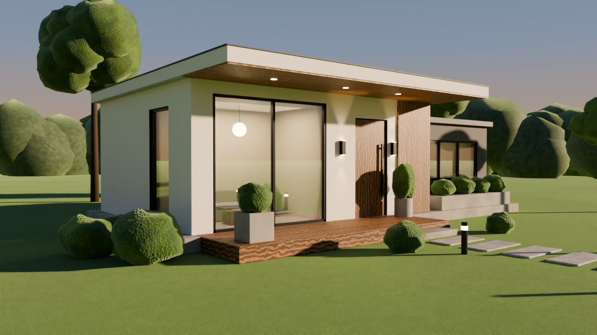
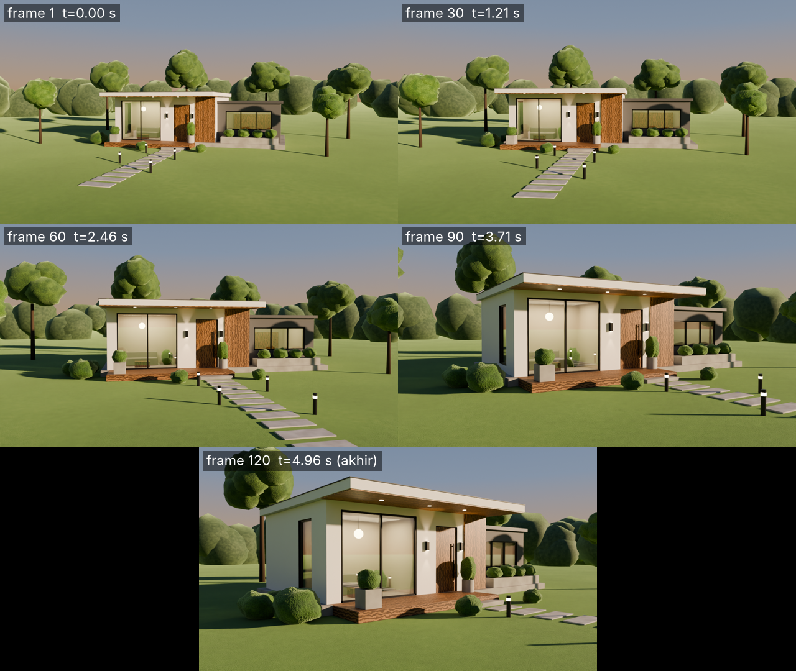

# Laporan Proyek: Minimalist House Cinematic Test

Laporan ini mencatat seluruh proses pembuatan video animasi 3D rumah minimalis modern berdurasi 5 detik dengan Blender Python API (`bpy`), mulai dari pemeriksaan environment, penyiapan tools, desain scene, pemilihan render engine, iterasi visual, render final, sampai verifikasi file video. Semua dikerjakan headless, tanpa GUI Blender, tanpa GPU, dan tanpa asset eksternal.

## Ringkasan hasil

| Item | Hasil |
|---|---|
| Status | Berhasil. MP4 tersimpan dan lolos verifikasi otomatis di script maupun pengecekan manual dengan ffprobe |
| Versi Blender | 5.3.0 (modul `bpy` dari PyPI, build `02f0899d78e3`) |
| Render engine | Cycles, device CPU, 28 samples adaptif + denoiser OpenImageDenoise |
| Jumlah frame | 120 frame |
| FPS | 24 |
| Resolusi | 1280 x 720 (16:9) |
| Durasi video | 5,000 detik (stream dan container) |
| Codec | H.264 profil High, yuv420p, 24/1 fps, bitrate sekitar 5,04 Mbps |
| Ukuran file MP4 | 3.152.868 byte (sekitar 3,0 MiB) |
| Waktu render | 38,6 detik untuk preview (frame 120) ditambah 3.784,6 detik (63 menit 5 detik) untuk 119 frame lainnya |
| Waktu total pipeline (build, preview, render, encode) | 3.832 detik (63 menit 52 detik) |



## 1. Target

Target utamanya video MP4 animasi 3D rumah minimalis modern 1 lantai, durasi tepat 5 detik (120 frame pada 24 fps), resolusi 1280x720. Rumah memakai warna putih, abu-abu, dan aksen kayu, dengan jendela kaca besar, pintu modern, teras, jalan setapak, rumput, tanaman, lampu eksterior, dan suasana golden hour. Kamera bergerak cinematic lalu berhenti di sudut depan-samping. Seluruh objek, material, lampu, dan animasi wajib dibuat dari script Python.

## 2. Pemeriksaan environment

Langkah pertama memeriksa apa saja yang sudah tersedia sebelum memasang apa pun.

| Pemeriksaan | Temuan |
|---|---|
| `import bpy` di Python sistem | Gagal, `ModuleNotFoundError: No module named 'bpy'` |
| Executable `blender` | Tidak ada. Pencarian di filesystem cuma menemukan file MIME `x-blender.xml` |
| Python | 3.13.18 |
| FFmpeg | 6.1.1 di `/usr/bin/ffmpeg`, encoder `libx264` tersedia |
| CPU / RAM / GPU | 4 core, 15 GiB RAM, tanpa GPU |
| Paket `bpy` di PyPI | Tersedia versi 5.1.0 sampai 5.3.0 untuk Python 3.13 |

Blender belum terpasang sama sekali, jadi pemasangan memang diperlukan dan tidak termasuk "instal ulang".

## 3. Penyiapan tools

### 3.1 Modul bpy

`bpy` 5.3.0 dipasang lewat pip di dalam virtualenv terpisah supaya Python sistem tetap bersih. Hasil pemeriksaan setelah instalasi:

- versi `5.3.0`, build `02f0899d78e3`
- `bpy.app.build_options.codec_ffmpeg = True`, jadi Blender sendiri juga bisa menulis video H.264
- Cycles tersedia dengan device CPU, denoiser bawaan OpenImageDenoise
- color management OCIO ter-load, view transform default AgX

### 3.2 Eevee tanpa GPU

Uji render Eevee pertama langsung gagal membuat context grafis karena Vulkan tidak bisa diinisialisasi dan `libEGL.so.1` tidak ada. Paket Mesa (`libegl1`, `libegl-mesa0`, `libgl1-mesa-dri`) kemudian dipasang lewat apt supaya Eevee bisa jalan memakai backend OpenGL di atas rasterizer software llvmpipe.

Setelah itu Eevee memang bisa merender, tetapi pelan karena seluruh pekerjaan GPU dijalankan CPU:

| Uji Eevee (scene kubus default) | Waktu |
|---|---|
| 320x180, sample default | 60,0 detik. Dugaan saya sebagian besar waktunya habis menunggu context shader yang gagal dibuat (log penuh pesan `EGL_BAD_MATCH`), tapi ini tidak diukur terpisah |
| 640x360, 64 sample, per frame | 46,6 / 47,1 / 43,8 detik |
| 640x360, 8 sample, per frame | 7,8 / 6,1 detik |

Keputusan engine ditunda sampai ada benchmark di scene asli (bagian 5).

## 4. Desain scene

Semua isi scene dibangun di `minimalist_house_animation.py`. Script mulai dari `read_factory_settings(use_empty=True)`, jadi hasilnya bisa diulang persis. Geometri dibuat dengan `bmesh` langsung, bukan operator GUI.

### 4.1 Arsitektur

Rumah terdiri dari dua massa. Massa utama berwarna putih berukuran 7,6 x 6 m dengan tinggi dinding 3,2 m di atas plinth beton 30 cm. Massa samping berwarna abu-abu arang dibuat mundur 0,8 m dari muka massa utama sehingga fasad punya kedalaman.

Bukaan dibuat dengan boolean (solver EXACT, mode material TRANSFER). Dengan cara ini permukaan hasil potongan otomatis memakai material pemotongnya, misalnya dinding ruang dalam berwarna krem hangat dan kusen berwarna antrasit. Hasil boolean lalu dibekukan ke mesh dan objek pemotong dihapus.

Elemen yang dibuat:

- jendela kaca besar dari lantai sampai plafon di fasad depan (3,1 x 2,9 m) dengan mullion tengah
- jendela vertikal di sisi kiri yang menyatu dengan ruang tamu
- jendela pita horizontal di massa abu-abu
- ruang dalam di balik kaca, berisi sofa, meja kopi, lampu gantung, rak, dan tanaman, supaya kaca tidak terlihat kosong
- pintu pivot kayu setinggi 2,58 m di dalam ceruk berlapis antrasit, dengan handle batang vertikal
- panel cladding kayu vertikal di kanan pintu
- atap datar kantilever yang menjorok 1,8 m menaungi teras, dengan plafon (soffit) kayu di bawahnya
- teras deck kayu, papan fascia di tepinya, dan satu anak tangga beton

### 4.2 Material

Semua material dibuat secara prosedural lewat node shader, tanpa satu pun file tekstur:

| Material | Cara dibuat |
|---|---|
| Plester putih dan abu-abu | Principled BSDF matte (roughness 0,7 sampai 0,85) dengan bump noise halus |
| Beton plinth dan paver | Dua warna abu-abu dicampur noise, ditambah bump noise skala kecil |
| Kayu | Wave texture mode BANDS untuk serat, white noise per papan untuk variasi warna, alur antar papan lewat operasi FRACT dan bump |
| Kaca | Campuran Transparent BSDF dan Glossy BSDF, faktor campuran dari Fresnel (Layer Weight) yang dipetakan ke 0,2 sampai 0,85, jadi kaca tembus pandang tapi tetap memantulkan langit |
| Rumput | Tiga warna hijau digerakkan noise skala besar dan sedang, bump noise skala 140, sedikit sheen |
| Daun | Noise 4D untuk warna, Voronoi untuk gumpalan daun dan bump |
| Lampu | Emission hangat (1,0 / 0,72 / 0,42) strength 18 |

### 4.3 Lanskap dan tanaman

- halaman rumput 400 x 400 m
- jalan setapak dari 11 paver beton
- 2 pohon di depan dan 4 pohon di belakang rumah. Tajuknya disusun dari 12 gumpalan icosphere yang dideformasi noise `mathutils` langsung di vertex, jadi bentuknya statis dan tidak "mendidih" saat tajuk bergoyang
- 12 semak, termasuk bedeng tanaman di depan massa abu-abu, tanaman pot di teras, dan tanaman di dalam rumah
- deretan pohon jauh (46 kelompok) yang melingkari halaman untuk menutup ujung bidang rumput di horizon. Objek ini dimatikan untuk shadow, diffuse, dan glossy ray, sehingga perannya murni latar

Gerakan daun dibuat dengan keyframe rotasi kecil (0,7 sampai 2 derajat) berbentuk sinus pada tajuk pohon dan semak, dengan pivot di puncak batang. Hasilnya goyangan angin yang halus tanpa simulasi.

### 4.4 Pencahayaan

| Sumber | Pengaturan |
|---|---|
| Matahari | Sun lamp, elevasi 13°, datang dari depan-kanan (azimut 58°), strength 9, warna hangat (1,0 / 0,72 / 0,46), sudut 1,5° untuk bayangan agak lembut |
| Langit | World shader gradasi buatan sendiri dari arah pandang: jingga di horizon, peach, biru muda, sampai biru tua di zenit. Strength 0,45 |
| Interior | 2 area light hangat (220 W dan 140 W) plus point light di lampu gantung |
| Eksterior | 2 sconce di samping pintu (spot atas dan bawah), 3 downlight di soffit, 4 bollard taman dengan point light |

Arah matahari dari depan-kanan sengaja dipilih supaya fasad depan kena sinar hangat sementara sisi kiri rumah berada dalam bayangan. Kontras dua sisi ini yang membuat volume rumah terbaca jelas dari kamera akhir.

### 4.5 Kamera dan animasi

Kamera perspektif 30 mm (sensor 36 mm) diarahkan dengan constraint Track To ke sebuah empty yang berfungsi sebagai titik fokus. Posisi kamera dan titik fokus dihitung per frame lalu di-keyframe di setiap frame 1 sampai 120.

Gerakannya berupa arc dolly. Azimut berubah dari 14° di kanan depan ke 38° di kiri depan, jarak turun dari 25 m ke 14,2 m, dan tinggi kamera turun dari 3,3 m ke 1,85 m. Progresnya memakai satu kurva smoothstep sepanjang 5 detik:

| Waktu | Progres gerakan | Isi frame |
|---|---|---|
| 0 sampai 1 detik | sekitar 10% | tampak depan lebar, kamera hampir diam, daun mulai bergoyang |
| 1 sampai 3 detik | sekitar 55% | kamera mendekat sambil mengorbit ke kiri, jendela, material, dan teras mulai dominan |
| 3 sampai 5 detik | sisa 35% | gerakan melambat lalu berhenti di framing depan-samping |

Kurva smoothstep punya kecepatan nol di awal dan di akhir, jadi kamera tidak tersentak saat mulai dan mendarat halus di framing akhir.

## 5. Pemilihan render engine

Brief meminta Eevee diprioritaskan bila tersedia. Eevee memang bisa jalan setelah Mesa dipasang, tetapi lewat rasterizer software. Keputusan akhirnya diambil dari benchmark frame 120 (frame paling dekat dan paling detail) di 1280x720:

| Konfigurasi | Waktu per frame | Catatan kualitas |
|---|---|---|
| Cycles CPU, 40 sample, denoise OIDN | 50,7 detik | bersih |
| Eevee via llvmpipe, 16 sample, frame pertama | 79,6 detik | kaca berbintik, kemungkinan dari transparansi dithered |
| Eevee via llvmpipe, steady state (frame 118 sampai 120) | 56,8 / 63,0 / 62,7 detik | sama seperti di atas |
| Cycles CPU, 28 sample, adaptive threshold 0,05, bounce dipangkas | 37,6 detik (render tunggal) | secara visual hampir identik dengan versi 40 sample |

Eevee kalah cepat sekaligus kalah bersih, sehingga render final memakai Cycles CPU. Opsi `--engine eevee` tetap ada di script untuk mesin yang punya GPU.

Optimasi Cycles yang dipakai:

- 28 sample dengan adaptive sampling (threshold 0,05)
- denoiser OpenImageDenoise memakai pass albedo dan normal, prefilter ACCURATE
- total bounce 4 (diffuse 2, glossy 2, transmission 2), caustics dimatikan, clamp indirect 8
- persistent data aktif supaya data scene tidak dibangun ulang di setiap frame. Waktu per frame saat render animasi berkisar 25,75 sampai 40,45 detik, makin lama ketika kamera makin dekat ke rumah
- geometri ringan: 72 objek, sekitar 40.202 segitiga sebelum bevel

## 6. Iterasi visual dan perbaikan

Sebelum render penuh, frame 1, 60, dan 120 dirender di resolusi 50% dengan 16 sample (sekitar 6 sampai 7 detik per frame) untuk mengecek komposisi. Dari situ ditemukan beberapa masalah:

| Iterasi | Masalah | Penyebab | Perbaikan |
|---|---|---|---|
| 1 | Script crash `KeyError: key "W" not found` | Socket W pada Noise Texture baru muncul setelah mode 4D aktif | Urutan diubah, `noise_dimensions = "4D"` di-set dulu |
| 2 | Golden hour tidak terasa, langit pucat, fasad rata | Matahari terlalu lemah dibanding langit | Elevasi matahari diturunkan dari 17° ke 13° dan digeser lebih ke samping, strength 4,2 ke 5,5, langit 1,0 ke 0,65 dengan warna lebih jenuh |
| 2 | Ujung rumput terlihat sebagai garis lurus di horizon | Bidang rumput berakhir di tengah frame | Ditambah deretan pohon jauh yang melingkar |
| 2 | Pohon mirip brokoli | Gumpalan noise terlalu besar dan seragam | Tajuk disusun ulang dari 12 gumpalan kecil dengan amplitudo noise lebih rendah |
| 2 | Pohon depan kiri menutup sebagian frame akhir | Posisi pohon tepat di jalur pandang kamera akhir | Pohon digeser ke (-10,4; -4,4) |
| 3 | Fasad tetap seperti mendung dan ada bayangan besar di rumput kanan | Deretan pohon jauh di sektor kanan depan menghalangi matahari rendah | Shadow, diffuse, dan glossy visibility deretan pohon dimatikan |
| 4 | Kontras cahaya masih lemah | Perbandingan sinar matahari dan langit sekitar 2:1 | Strength matahari dinaikkan 5,5 ke 9, langit diturunkan 0,65 ke 0,45 |
| 5 | Sisi depan deck bermotif loreng | Wave texture kayu terbaca tegak lurus arah serat di permukaan itu | Ditambah papan fascia horizontal di depan, kiri, dan kanan deck |
| 6 | Pipeline render pertama langsung berhenti dengan exit 127 | `/usr/bin/time` tidak ada di container | Pengukuran waktu diganti dengan `date +%s` di shell |

## 7. Render final dan encoding

Pipeline final dijalankan dengan satu perintah `--mode all`:

1. scene dibangun ulang dari nol (0,62 detik)
2. preview frame 120 dirender ke `preview.png` (38,6 detik), lalu file itu ikut dipakai sebagai frame 120 di sequence supaya tidak dirender dua kali
3. frame 1 sampai 119 dirender ke PNG sequence. Opsi `use_overwrite = False` membuat frame yang sudah ada dilewati, jadi render yang terputus bisa dilanjutkan
4. PNG sequence di-encode dengan executable ffmpeg: `libx264`, preset slow, CRF 18, `yuv420p`, `+faststart`, 24 fps
5. hasil dicek otomatis dengan ffprobe. Script berhenti dengan error kalau video tidak tepat 120 frame, 1280x720, dan 5,000 detik

Script juga menyiapkan jalur cadangan bila executable ffmpeg tidak ada, yaitu encode memakai FFmpeg bawaan Blender lewat Video Sequencer tanpa render 3D ulang. Di environment ini jalur cadangan tersebut tidak terpakai karena ffmpeg tersedia.

Waktu render:

| Tahap | Waktu |
|---|---|
| Render animasi (119 frame) | 3.784,6 detik (63 menit 5 detik) |
| Rata-rata per frame | 31,8 detik. Tercepat 25,75 detik (frame 8, kamera masih jauh), terlama 40,45 detik (frame 116, kamera paling dekat) |
| Encode H.264 | 7,0 detik |
| Total pipeline | 3.832 detik (63 menit 52 detik) |

## 8. Verifikasi video

Hasil ffprobe pada `minimalist_house_test.mp4`:

```
codec_name=h264
profile=High
width=1280
height=720
pix_fmt=yuv420p
r_frame_rate=24/1
avg_frame_rate=24/1
nb_frames=120
stream duration=5.000000
format duration=5.000000
size=3152868
bit_rate=5044588
nb_read_frames (decode penuh)=120
```

Decode penuh dengan `ffmpeg -v error -i minimalist_house_test.mp4 -f null -` selesai tanpa satu pun error, dan jumlah frame yang benar-benar terbaca saat decode tetap 120. Video ini memenuhi seluruh spesifikasi teknis: 120 frame, 24 fps, 1280x720, durasi 5,000 detik, H.264. Script sendiri juga mencatat `"video_ok": true` di `render_report.json`.

## 9. Hasil visual

Lima frame dari awal sampai akhir animasi:



Frame 1 membuka dengan tampak depan lebar dari sisi kanan. Seluruh rumah, jalan setapak dengan bollard, pohon, dan langit senja masuk ke frame. Sampai detik ke-1,2 kamera nyaris belum bergeser, sesuai rencana establishing shot. Di detik 2,5 kamera sudah berada hampir tepat di depan rumah dan lebih dekat, sehingga jendela kaca dengan interior yang menyala, pintu kayu, cladding, dan sconce mulai terbaca jelas. Di detik 3,7 orbit berlanjut ke kiri dan sisi kiri rumah yang berada dalam bayangan mulai terlihat. Frame terakhir mendarat di sudut depan-kiri dengan kamera setinggi mata (1,85 m). Fasad depan yang terkena sinar hangat, sisi kiri yang gelap, plafon kayu dengan downlight, dan teras menjadi fokus utama.

Gerakan kamera mulus dari awal sampai akhir karena posisi dihitung dari satu kurva smoothstep dan di-keyframe di setiap frame. Daun pohon dan semak bergoyang tipis sepanjang video.

## 10. Keterbatasan

- Pohon dan semak masih bergaya stilisasi (gumpalan icosphere), belum setara aset vegetasi fotorealistik. Pilihan ini disengaja demi geometri ringan dan tanpa asset eksternal.
- Kaca memakai campuran Transparent dan Glossy, bukan refraksi fisik. Untuk kaca jendela tipis hasilnya cukup meyakinkan secara visual dan lebih murah dirender.
- Eevee tidak dipakai karena di mesin tanpa GPU Eevee berjalan lewat rasterizer software yang terukur lebih lambat dari Cycles CPU.
- Venv `bpy` dan paket Mesa hanya ada di container sesi ini. Di mesin lain keduanya perlu dipasang lagi (lihat bagian 11).

## 11. Cara menjalankan ulang

```bash
python3 -m venv bpyenv
./bpyenv/bin/pip install bpy==5.3.0

# pipeline lengkap: preview, render 120 frame, encode, verifikasi
./bpyenv/bin/python minimalist_house_animation.py --mode all

# opsi lain
./bpyenv/bin/python minimalist_house_animation.py --mode preview --preview-frame 60
./bpyenv/bin/python minimalist_house_animation.py --mode anim --start 1 --end 60
./bpyenv/bin/python minimalist_house_animation.py --mode encode
./bpyenv/bin/python minimalist_house_animation.py --mode preview --res-pct 50 --samples 16   # cek cepat
./bpyenv/bin/python minimalist_house_animation.py --engine eevee                           # mesin dengan GPU
```

Dengan executable Blender biasa: `blender -b -P minimalist_house_animation.py -- --mode all`.

## 12. Lokasi file

| File | Isi |
|---|---|
| `minimalist_house_test/minimalist_house_animation.py` | Script Blender lengkap |
| `minimalist_house_test/minimalist_house_test.mp4` | Video animasi 5 detik |
| `minimalist_house_test/preview.png` | Preview frame 120 |
| `minimalist_house_test/contact_sheet.png` | Lima frame contoh dari awal sampai akhir |
| `minimalist_house_test/render_report.json` | Log angka render yang ditulis otomatis oleh script |
| `minimalist_house_test/LAPORAN.md` | Laporan ini |

Semua file di atas ada di branch `claude/minimalist-house-animation-tfoo33` repo `haikalmumtaz111-cyber/skeptod`. PNG sequence 120 frame tidak ikut di-commit supaya repo tetap ringan.
